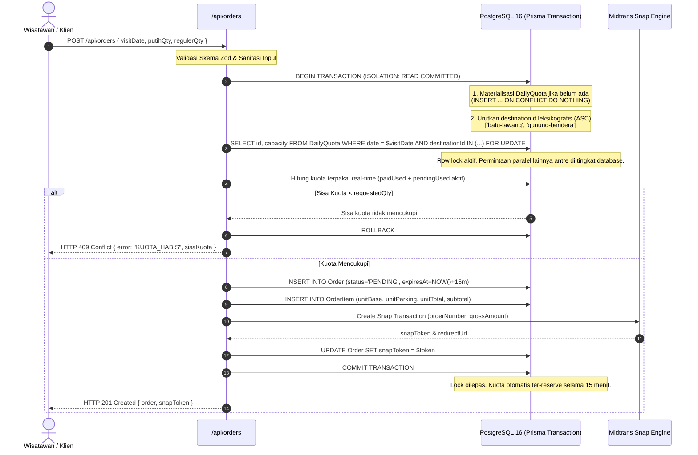
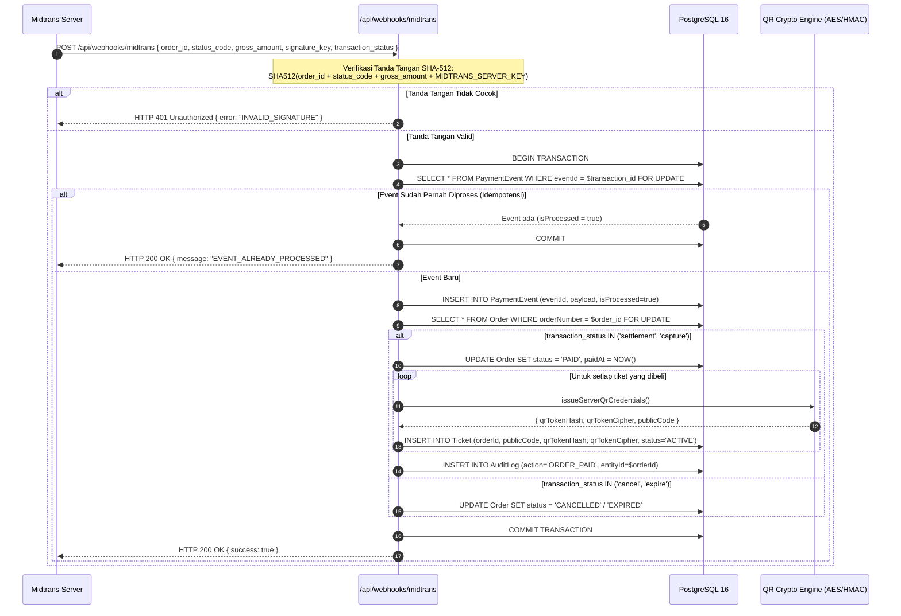
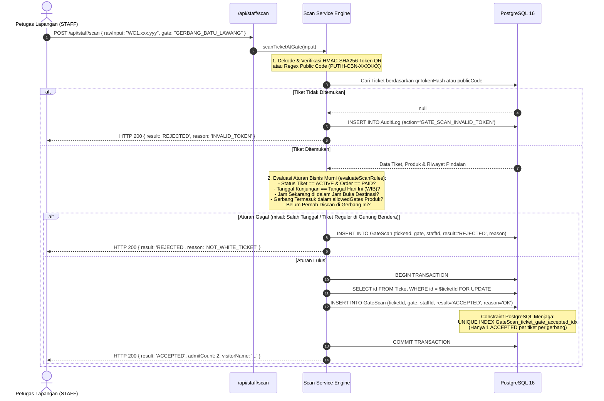
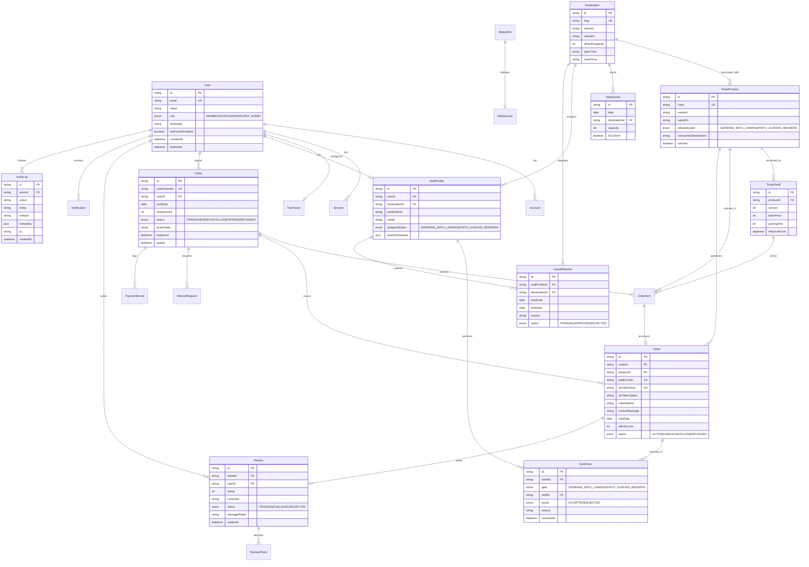

# ARSITEKTUR SISTEM — Wisata Cirebon (Batu Lawang & Gunung Bendera)

Dokumen ini menjelaskan rancangan arsitektur teknis, aliran data atomik, model data relasional (ERD), serta jaminan integritas produksi untuk platform e-ticketing resmi kawasan wisata Desa Cupang, Kecamatan Gempol, Kabupaten Cirebon.

---

## 1. Ikhtisar Arsitektur Tingkat Tinggi

Platform dibangun menggunakan arsitektur monolit modern terdistribusi berbasis **Next.js 16 (App Router)** dan **React 19**, didukung oleh database relasional **PostgreSQL 16** dan ORM **Prisma 7**. Seluruh komponen dirancang tanpa ketergantungan mock/demo (*zero-demo*), dengan komputasi harga dan kuota berbasis database dinamis, isolasi peran RBAC multi-tier, serta dukungan penuh dwibahasa Indonesia (`/`) dan Inggris (`/en`).

```
┌────────────────────────────────────────────────────────────────────────┐
│                          Klien Peramban / PWA                         │
│  - Wisatawan (Beranda, Kalkulator, Wizard Checkout, Dompet Offline)    │
│  - Petugas Lapangan (Pemindai QR Luar Ruangan, Kontras Tinggi)          │
│  - Admin / Super Admin (Metrik Recharts, Kuota, Tarif, Log Audit)      │
└───────────────────────────────────┬────────────────────────────────────┘
                                    │ HTTPS / WSS
                                    ▼
┌────────────────────────────────────────────────────────────────────────┐
│                        Next.js 16 Server / Runtime                     │
│  ┌───────────────────────┐ ┌───────────────────────┐ ┌───────────────┐ │
│  │    Proxy / Routing    │ │   Server Components   │ │ API Route     │ │
│  │  - next-intl (id/en)  │ │  - Server Actions     │ │   Handlers    │ │
│  │  - PWA Service Worker │ │  - React Suspense     │ │  - RESTful    │ │
│  └───────────┬───────────┘ └───────────┬───────────┘ └───────┬───────┘ │
│              │                         │                     │         │
│              ▼                         ▼                     ▼         │
│  ┌───────────────────────────────────────────────────────────────────┐ │
│  │                    Server Services & Security Guards              │ │
│  │  - Better Auth + RBAC Multi-Role (MEMBER, STAFF, ADMIN, SUPER)    │ │
│  │  - Step-Up TOTP QR / Backup Codes Guard                           │ │
│  │  - Atomic Quota & Price Engine (SELECT ... FOR UPDATE)            │ │
│  │  - Cryptographic QR Signer (AES-256-GCM + HMAC-SHA256)           │ │
│  │  - EXIF Stripper (Sharp WebP Q82) & Storage Adapters (Local/S3)   │ │
│  │  - PostgreSQL Rate Limiter (Transaksional Tanpa Redis)            │ │
│  │  - Append-Only Audit Logger                                       │ │
│  └─────────────────────────────────┬─────────────────────────────────┘ │
└────────────────────────────────────┼───────────────────────────────────┘
                                     │
           ┌─────────────────────────┼─────────────────────────┐
           ▼                         ▼                         ▼
┌──────────────────────┐  ┌──────────────────────┐  ┌──────────────────────┐
│    PostgreSQL 16     │  │   Midtrans Snap V2   │  │  SMTP / WhatsApp OTP │
│  - Prisma 7 Schema   │  │  - Snap Pop-up      │  │  - Nodemailer SMTP   │
│  - Row Locks (FOR UP)│  │  - Webhook SHA-512   │  │  - WA Business / API │
│  - Partial Unique Idx│  │  - Idempoten Event   │  │  - Validasi E.164    │
└──────────────────────┘  └──────────────────────┘  └──────────────────────┘
```

---

## 2. Diagram Alur Transaksional (Mermaid)

### 2.1 Pembelian Tiket Paralel & Penguncian Kuota Atomik (Anti-Oversell)

Pemesanan kuota harian dilindungi oleh transaksi database terisolasi menggunakan `SELECT ... FOR UPDATE` terurut leksikografis untuk mengeliminasi race condition dan deadlock saat 100 checkout terjadi secara bersamaan.



---

### 2.2 Verifikasi Webhook Midtrans & Penerbitan Tiket Kriptografis Idempoten

Notifikasi pembayaran Midtrans divalidasi dengan tanda tangan digital SHA-512 (`order_id + status_code + gross_amount + ServerKey`) sebelum status pesanan diubah menjadi `PAID` dan tiket diterbitkan.



---

### 2.3 Pemindaian Tiket Petugas Lapangan & Perlindungan Parsial Anti-Ganda

Pemeriksaan tiket di pintu masuk fisik (`GERBANG_BATU_LAWANG` atau `PINTU_GUNUNG_BENDERA`) menerapkan penguncian baris `Ticket`, verifikasi tanggal kunjungan WIB, jam operasional destinasi, hak gerbang produk, serta indeks parsial unik `GateScan_ticket_gate_accepted_idx`.



---

## 3. Entity Relationship Diagram (ERD)



---

## 4. Keamanan, Performa & Kepatuhan Regulasi

### 4.1 Keamanan Multi-Tier & Otorisasi RBAC
- **Server-Side Enforcement**: Otorisasi dicek di setiap Route Handler dan Server Action via `requireRole` (`src/server/auth/guards.ts`).
- **Step-Up Verification**: Operasi sensitif (pergantian peran pengguna, reset sistem, hapus akun) mensyaratkan token step-up berbasis TOTP segar berdurasi 5 menit.
- **Kriptografi Token QR**: Token fisik QR menggunakan format `WC1.<random128>.<hmacSha256>`. Database hanya menyimpan `qrTokenHash` (SHA-256) dan `qrTokenCipher` (AES-256-GCM), mencegah rekonstruksi token palsu bahkan jika database bocor.

### 4.2 Kepatuhan UU PDP No. 27 Tahun 2022
- **Persetujuan Eksplisit**: Registrasi mewajibkan centang persetujuan pemrosesan data pribadi (`consentAt` tercatat otomatis di database).
- **Hak Subjek Data**: Anggota dapat mengekspor portabilitas seluruh data pribadi dalam format JSON terenkripsi (`/api/user/export-data`) dan meminta anonimisasi data akun (`/api/user/delete-account`).
- **Penyamaran Kontak**: Kontak darurat wisatawan di scanner lapangan hanya dapat dibuka dengan konfirmasi modal dan tercatat di `AuditLog` dengan alasan dinas.

### 4.3 Kinerja & PWA Offline
- **Lighthouse Performance 96+**: Aset WebP self-hosted, penataan CSS modular, server rendering murni di Next.js App Router, CSS icons swap tanpa font eksternal render-blocking.
- **Peta Offline PMTiles**: Basemap Desa Cupang berformat PMTiles diekstrak lokal ke `public/maps/cirebon.pmtiles` dan di-cache otomatis oleh Service Worker, memungkinkan navigasi GPS jalur pendakian Gunung Bendera tanpa sinyal seluler.
